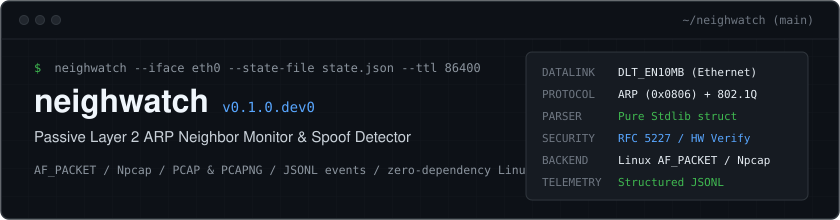
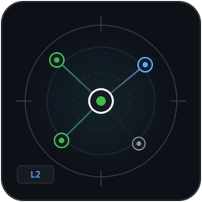
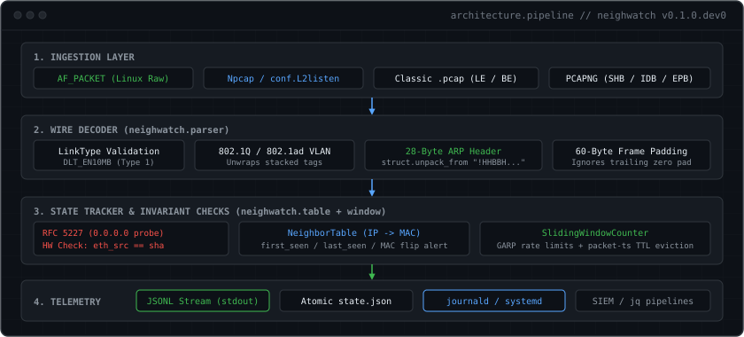

<p align="center">
  
</p>

<p align="center">
  
</p>

## OVERVIEW

`neighwatch` is a passive Layer 2 ARP neighbor monitor and spoof detector. It inspects Ethernet and ARP wire frames, tracks an in-memory `IP -> MAC` binding table, evaluates packet-timestamp sliding windows for gratuitous ARP floods, and emits normalized JSONL events to `stdout`.

### Threat Model & Detection Surface

- **Silent MAC Flaps:** Detects when an existing IP binding is claimed by a new hardware address (`arp_mac_change`), characteristic of ARP cache poisoning and MITM gateway impersonation.
- **Hardware Address Mismatches:** Inspects both the outer Ethernet frame source (`eth_src`) and the inner ARP sender hardware address (`sha`). Inconsistencies (`arp_hw_mismatch`) trigger immediate alerts and are quarantined from updating the trusted table.
- **RFC 5227 Probe Isolation:** Tracks Duplicate Address Detection (DAD) probes (`spa == 0.0.0.0`) as informational events (`arp_probe`) without polluting `0.0.0.0` into the active neighbor table.
- **Gratuitous ARP Floods:** Measures burst frequency over sliding time windows across both IP and MAC scopes, isolating cache-spray attacks (`arp_gratuitous_flood`) with per-key alert cooldowns.
- **Stale Neighbor Eviction:** Prunes inactive bindings based on elapsed packet capture time (`--ttl`), emitting structured expiration records (`arp_expired`).

---

## ARCHITECTURE

<p align="center">
  
</p>

### Event Schema

Every event is serialized as a single-line JSON object with deterministic keys:

| Field | Type | Description |
| :--- | :--- | :--- |
| `ts` | `string` | ISO-8601 UTC timestamp (`YYYY-MM-DDTHH:MM:SS.ffffffZ`) |
| `tool` | `string` | Always `"neighwatch"` |
| `event` | `string` | Event classifier (e.g. `arp_learned`, `arp_mac_change`) |
| `severity` | `string` | `"info"`, `"warn"`, or `"alert"` |
| `src_ip` | `string|null` | Sender protocol IPv4 address (`spa`) |
| `src_mac` | `string|null` | Sender hardware MAC address (`sha`) |
| `detail` | `object` | Contextual dictionary (operation, target addresses, VLAN tags, flood counters) |

#### Event Types

- `arp_learned` (`info`): Newly observed valid IP-to-MAC mapping.
- `arp_seen` (`info`): Known binding re-observed (emitted when `--all` is set).
- `arp_mac_change` (`alert`): Known IP address claimed by a different MAC address.
- `arp_hw_mismatch` (`alert`): Outer Ethernet frame source does not match inner ARP hardware address.
- `arp_gratuitous_flood` (`alert`): Gratuitous ARP burst exceeded rate threshold within window.
- `arp_gratuitous` (`info`): Unchanged or unthrottled gratuitous ARP announcement.
- `arp_probe` (`info`): Valid RFC 5227 IPv4 address conflict detection probe (`spa=0.0.0.0`).
- `arp_invalid_spa` (`warn`): ARP reply claiming sender protocol address `0.0.0.0`.
- `arp_invalid_sha` (`warn`): ARP packet claiming broadcast (`ff:ff:ff:ff:ff:ff`), zero, or multicast MAC.
- `arp_unexpected_op` (`warn`): ARP opcode other than `1` (`who-has`) or `2` (`is-at`).
- `arp_expired` (`info`): Stale neighbor evicted after exceeding configured `--ttl`.
- `arp_malformed` (`warn`): Truncated Ethernet header or undersized ARP payload.

---

## BUILD & INSTALLATION

`neighwatch` requires **Python 3.10+**.

### Linux (Zero External Dependencies)

On Linux, `neighwatch` uses standard library raw sockets (`AF_PACKET`) and requires no third-party packages:

```sh
git clone https://github.com/netequator/neighwatch.git
cd neighwatch
pip install -e .
```

### Windows (Npcap / Scapy)

On Windows, install with the optional packet capture extra:

```powershell
pip install -e ".[pcap]"
```

Ensure Npcap is installed with "WinPcap API-compatible mode" enabled.

---

## USAGE

### 1. Offline PCAP & PCAPNG Replay

Replay an existing packet capture (classic `.pcap` or modern `.pcapng` from Wireshark / `dumpcap`) with pure stdlib stream decoding:

```sh
neighwatch --pcap capture.pcapng
# or:
python3 -m neighwatch --pcap capture.pcap
```

### 2. Live Linux Capture (Native `AF_PACKET`)

Capture live ARP frames without root privileges using Linux ambient capabilities:

```sh
# Grant CAP_NET_RAW capability to python binary once:
sudo setcap cap_net_raw=eip $(which python3)

# Run unprivileged monitor with persistent state and 24-hour TTL:
neighwatch --iface eth0 --state-file /var/lib/neighwatch/state.json --ttl 86400
```

### 3. Live Windows Capture (Npcap)

```powershell
python -m neighwatch --iface "vEthernet (WSL)" --state-file state.json --ttl 3600
```

### 4. CLI Reference

| Flag | Argument | Description | Default |
| :--- | :--- | :--- | :--- |
| `-r`, `--pcap` | `PATH` | Read offline classic `.pcap` file | `None` |
| `-i`, `--iface` | `NAME` | Capture live ARP frames on interface | `None` |
| `--all` | - | Emit `arp_seen` events for unchanged known bindings | `False` |
| `-c`, `--count` | `INT` | Live capture frame limit (`0` = unlimited) | `0` |
| `-t`, `--timeout` | `FLOAT` | Live capture timeout in seconds | `None` |
| `-s`, `--state-file` | `PATH` | JSON file path to load and persist neighbor state | `None` |
| `--ttl` | `FLOAT` | Entry time-to-live in seconds (`0` = disabled) | `0.0` |
| `--garp-window` | `FLOAT` | Gratuitous ARP flood detection window in seconds | `10.0` |
| `--garp-threshold`| `INT` | Gratuitous ARP count before alert (`0` = disabled) | `5` |
| `--backend` | `CHOICE` | Backend engine: `auto`, `native` (`AF_PACKET`), `scapy` | `auto` |

---

## SYSTEMD DAEMON (LINUX)

A production-grade systemd service unit is included at [systemd/neighwatch.service](systemd/neighwatch.service). It runs under a dynamic unprivileged user with strictly bounded ambient capabilities (`CAP_NET_RAW`) and comprehensive filesystem isolation:

```ini
[Unit]
Description=neighwatch Layer 2 ARP Neighbor Monitor Daemon
Documentation=https://github.com/netequator/neighwatch
After=network.target

[Service]
Type=simple
ExecStart=/usr/local/bin/neighwatch -i eth0 --state-file /var/lib/neighwatch/state.json --ttl 86400
Restart=always
RestartSec=5s

DynamicUser=yes
AmbientCapabilities=CAP_NET_RAW
CapabilityBoundingSet=CAP_NET_RAW

StateDirectory=neighwatch
ProtectSystem=strict
ProtectHome=yes
ProtectKernelTunables=yes
ProtectControlGroups=yes
NoNewPrivileges=yes
RestrictRealtime=yes
RestrictSUIDSGID=yes

StandardOutput=journal
StandardError=journal

[Install]
WantedBy=multi-user.target
```

### Deployment

```sh
sudo cp systemd/neighwatch.service /etc/systemd/system/
sudo systemctl daemon-reload
sudo systemctl enable --now neighwatch

# Stream structured JSONL alerts in real time:
journalctl -u neighwatch -f -o cat | jq .
```

---

## TESTING & VERIFICATION

Run the deterministic test suite:

```sh
pytest tests/ -v
```

Run static analysis:

```sh
ruff check .
```

The test harness uses synthetic binary frame generation (`struct.pack`) across 4 test modules:
- `tests/test_parser.py`: Frame parsing, 802.1Q VLAN unwrapping, and 60-byte padding truncation.
- `tests/test_window.py`: Rate-limiting counters, sliding windows, and alert cooldowns.
- `tests/test_table.py`: Neighbor learning, MAC flaps, RFC 5227 probes, hardware mismatches, and state serialization.
- `tests/test_pcap.py`: Endianness, microsecond/nanosecond header decoding, and PCAP stream iteration.

---

## LIMITATIONS

- **Link-Type Restrictions:** Requires `DLT_EN10MB` (Ethernet, datalink type 1). Captures on loopback (`DLT_NULL`) or Linux cooked interfaces (`LINUX_SLL`) fail fast with exit code `2`.
- **Capture Formats:** Supports classic `.pcap` (microsecond and nanosecond timestamps) and `.pcapng` (SHB, IDB, EPB, SPB).
- **Protocols:** Currently parses IPv4 ARP. IPv6 Neighbor Discovery Protocol (NDP `NS`/`NA`) is queued for Day 4 (`#3`).

---

## ROADMAP & SPRINT STATUS

- [x] Day 1: PoC, classic PCAP reader, RFC 5227 probe exclusion, sliding-window gratuitous flood detection, state persistence, TTL eviction, and Linux native `AF_PACKET` capture (`#1`, `#2`, `#6` closed).
- [x] Day 2: Modular package extraction (`neighwatch/`), standard packaging (`pyproject.toml`), and 23-test deterministic `pytest` suite (`#5` closed).
- [x] Day 3: Zero-dependency `.pcapng` block decoder (`#4` closed).
- [ ] Day 4: IPv6 NDP (`NS`/`NA`) and DAD (`::`) protocol parsing, release tag `v0.1.0` (`#3`).
